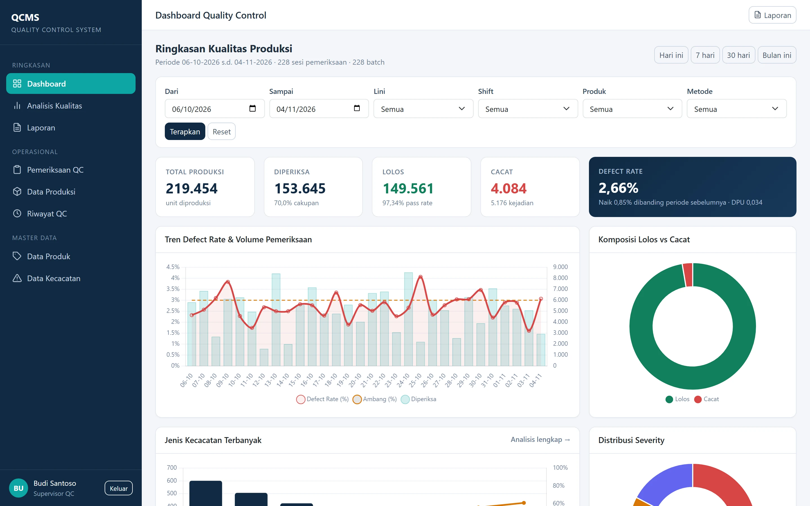
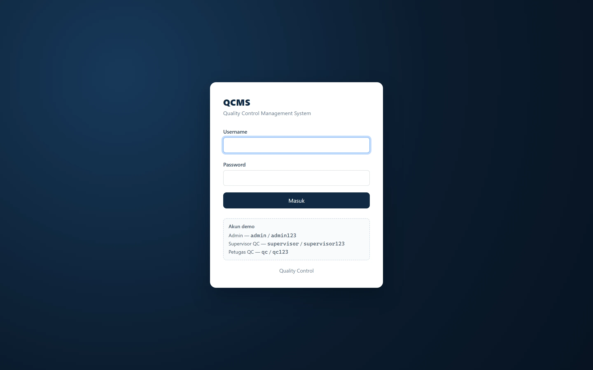
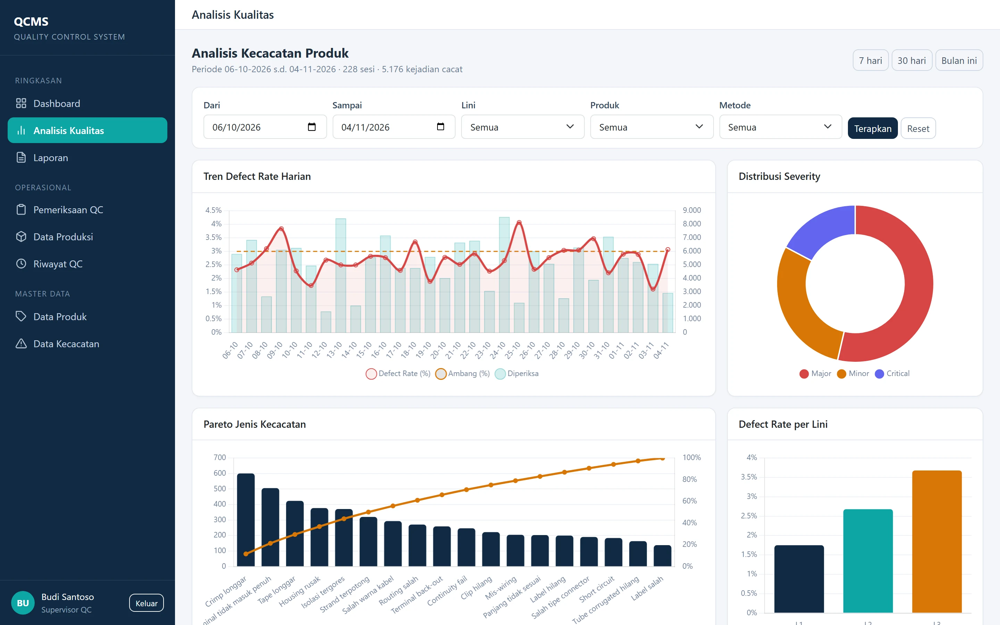
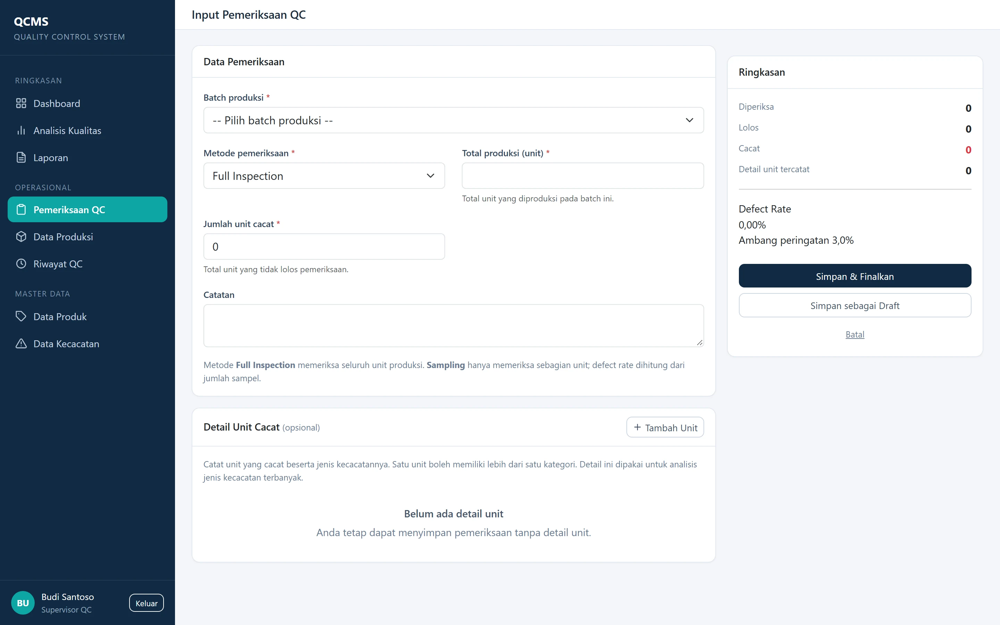
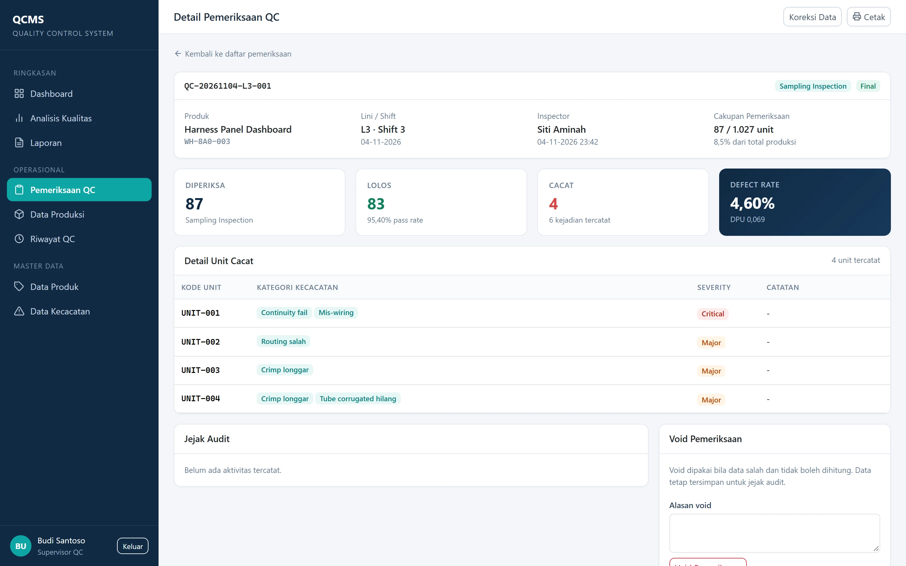
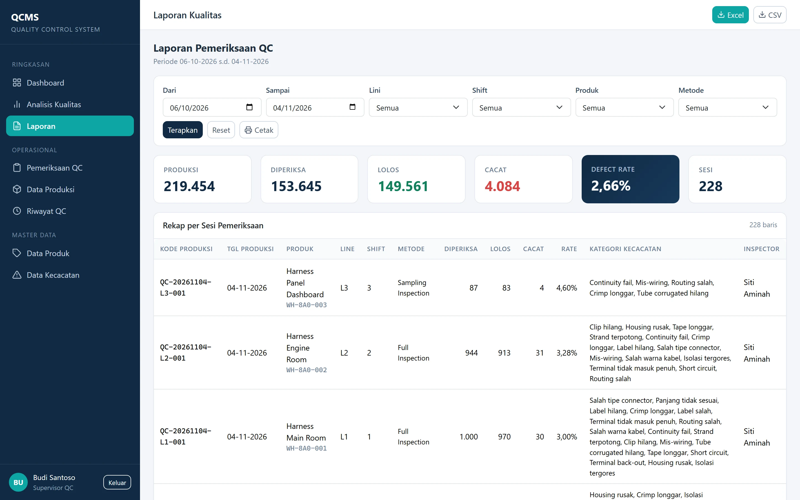
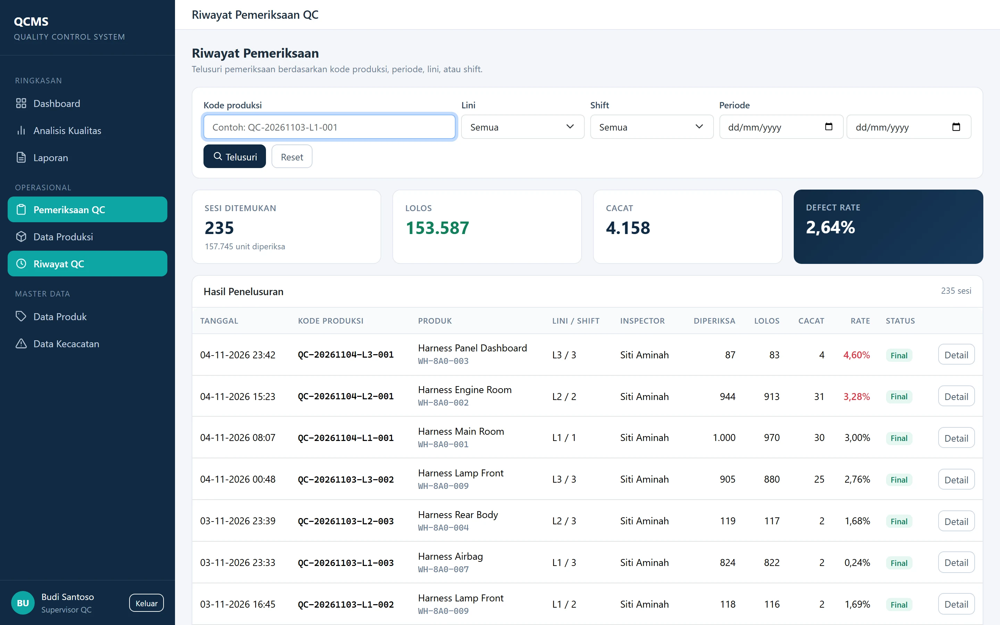
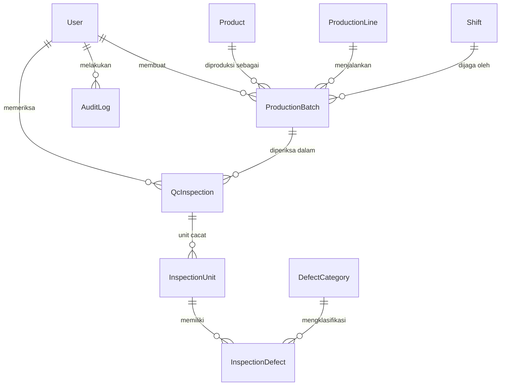

# QCMS — Quality Control Management System

[English](README.md) · **Bahasa Indonesia**

Aplikasi web untuk mencatat hasil pemeriksaan Quality Control rangkaian kabel
(*wiring harness*) otomotif: kode produksi otomatis, pencatatan cacat sampai
tingkat unit, dashboard defect rate, analisis Pareto, dan export CSV/Excel.

Dibangun dengan **Python 3.12 · Django 6 · PostgreSQL / SQLite · Docker**.
Tanpa perangkat IoT, tanpa framework JavaScript — sengaja dibuat cukup kecil
agar bisa dirawat satu orang di dalam pabrik.



---

## Masalah yang diselesaikan

Di pabrik wiring harness, hasil pemeriksaan QC dicatat di kertas per shift.
Tiga hal yang lalu salah:

1. **Rekap memakan waktu.** Seseorang mengetik ulang seluruh shift ke Excel.
2. **Penelusuran hilang.** Saat pelanggan melaporkan cacat, tidak ada yang bisa
   menemukan pemeriksaan mana yang mencakup kode produksi tersebut.
3. **Perhitungan defect rate diam-diam salah.** Kesalahan paling umum adalah
   membagi unit cacat dengan *total produksi*, bukan dengan *unit yang benar-benar
   diperiksa*. Pada metode sampling, cara itu menurunkan angka secara drastis —
   sering sampai satu orde besaran.

QCMS menggantikan formulir kertas dan mencegah kesalahan nomor 3 sejak awal.

## Fitur

| Halaman | Fungsi |
|---|---|
| Login | Tiga role: Admin, Supervisor QC, Petugas QC |
| Dashboard | KPI, tren defect rate, komposisi lolos/cacat, peringatan ambang |
| Input pemeriksaan | Full inspection atau sampling, detail cacat multi-kategori per unit |
| Data produksi | Batch dengan kode otomatis `QC-YYYYMMDD-L<n>-<urut>` |
| Riwayat QC | Telusur berdasarkan kode produksi, periode, lini, shift |
| Analisis kualitas | Tren harian, Pareto jenis kecacatan, severity, per lini/produk |
| Laporan | Rekap per sesi, export CSV & Excel, tata letak cetak |
| Master data | Produk, lini produksi, shift, kategori kecacatan |
| Manajemen pengguna | Akun dan pembagian role |

## Tangkapan layar

| | |
|---|---|
|  |  |
| **Login** — akses berbasis role | **Analisis** — Pareto dan sebaran severity |
|  |  |
| **Input pemeriksaan** — cepat di lantai produksi | **Detail** — cacat per unit, jejak audit |
|  |  |
| **Laporan** — rekap dan export | **Riwayat** — penelusuran per kode produksi |

Selengkapnya di [`docs/screenshots/`](docs/screenshots/).

---

## Keputusan teknis

Bagian ini yang paling penting. Setiap keputusan punya konsekuensinya.

### 1. Defect rate dihitung dari unit yang diperiksa, bukan total produksi

```
defect_rate = qty_fail / qty_inspected × 100
```

Pada *full inspection*, `qty_inspected == total_production`. Pada *sampling*
keduanya berbeda, dan memakai total produksi menghasilkan angka yang terlihat
menenangkan tetapi salah. Kasus acuan — 1.000 diperiksa, 970 lolos, 30 cacat —
harus menghasilkan tepat **3,00%**, dan ada tes yang memastikannya.

### 2. Model hibrida: agregat di header, detail hanya untuk unit cacat

Satu batch bisa 1.200 unit. Menyimpan 1.200 baris per pemeriksaan membuat input
di lantai produksi lambat dan database membengkak tanpa manfaat.

```
QcInspection   qty_inspected / qty_pass / qty_fail   ← selalu ada
InspectionUnit     hanya untuk unit yang benar-benar cacat
InspectionDefect   satu baris per kategori cacat per unit cacat
```

Detail bersifat **opsional**: petugas bisa mencatat 30 unit cacat dalam hitungan
detik tanpa menyebut kategorinya. Halaman detail lalu menampilkan berapa unit
cacat yang belum punya kategori, sehingga celahnya terlihat, bukan hilang diam-diam.

### 3. Pareto menghitung *kejadian* cacat; defect rate menghitung *unit*

Satu unit bisa membawa beberapa cacat (crimp longgar **dan** salah warna kabel).
Keduanya menjawab pertanyaan berbeda:

- *Berapa unit yang harus saya buang?* → unit → defect rate
- *Apa yang harus diperbaiki lebih dulu?* → kejadian → Pareto

Keduanya ditampilkan, ditambah **DPU** (cacat per unit) agar kedua pandangan bisa
direkonsiliasi. Mencampuradukkan keduanya adalah kesalahan analisis paling umum
di dashboard QC.

### 4. Data tidak pernah dihapus — di-*void* dengan alasan wajib

`status` bernilai `draft`, `final`, atau `void`. Sesi void dan draft dikeluarkan
dari seluruh dashboard dan laporan, tetapi barisnya tetap ada bersama
`void_reason`, `voided_by`, dan `voided_at`. Sesi final hanya dapat dikoreksi
Supervisor atau Admin, dan setiap koreksi menulis entri `AuditLog`.

Untuk sistem mutu, catatan yang bolong lebih buruk daripada catatan salah yang
terlihat dikoreksi.

### 5. Kode produksi dibuat per lini dan per tanggal, di dalam transaksi

```
QC-20261103-L1-001
   │        │  └─ urutan, reset harian per lini
   │        └──── lini produksi
   └───────────── tanggal produksi
```

`select_for_update()` ditambah retry pada `IntegrityError` menangani insert
bersamaan. Satu counter global akan lebih sederhana, tetapi tidak terbaca di
lantai produksi, tempat orang menyebut kode secara lisan.

### 6. Export Excel menulis angka asli, bukan teks

`openpyxl` dengan senang hati menulis `"4,60"` sebagai string. File tampak benar
dan tidak bisa dijumlahkan. Kolom angka ditulis sebagai `int`/`float` dengan
format `#,##0` / `0.00`, sehingga `SUM` dan `AVERAGE` langsung bekerja.

### 7. Bootstrap dan Chart.js disimpan lokal

Jaringan pabrik sering offline atau dibatasi ketat. `static/vendor/` menyimpan
library-nya; tidak ada ketergantungan CDN saat aplikasi berjalan.

### 8. Container selalu berjalan dengan `DEBUG=False`

`DEBUG` di `.env` hanya berlaku untuk `runserver` lokal. File compose menetapkan
`DEBUG: "False"` secara hardcode, sehingga `.env` yang salah tidak bisa
membocorkan traceback ke lantai produksi.

---

## Arsitektur



| App | Tanggung jawab |
|---|---|
| `core` | Layout, navigasi, decorator RBAC, template tag, seed demo |
| `accounts` | `User` kustom dengan `role`, login, manajemen pengguna |
| `masterdata` | Produk, lini, shift, kategori kecacatan |
| `production` | Batch dan generator kode produksi |
| `inspection` | Sesi pemeriksaan, unit, cacat, layanan void/koreksi |
| `reporting` | Dashboard, analisis, laporan, export CSV/XLSX |
| `auditlog` | Jejak tindakan create/update/void yang tidak dapat diubah |

Logika bisnis berada di modul `services.py`, bukan di view, sehingga perhitungan
dapat diuji tanpa HTTP.

```
config/            settings, urls, wsgi
apps/              satu Django app per bounded context
templates/         template Bootstrap, satu folder per app
static/            css, js, library vendor
docs/              PRD, catatan keputusan, tangkapan layar
scripts/           generator tangkapan layar
```

---

## Menjalankan

### Docker (disarankan)

```bash
docker compose up -d --build
```

Buka <http://localhost:8080>. Migrasi dan data demo berjalan otomatis pada
start pertama.

| Role | Username | Password |
|---|---|---|
| Admin | `admin` | `admin123` |
| Supervisor QC | `supervisor` | `supervisor123` |
| Petugas QC | `qc` | `qc123` |

> Port **8080** dipakai karena 8000 sering sudah terpakai. Ubah di
> `docker-compose.yml` bagian `ports`.

### Lokal, tanpa Docker

```bash
python -m venv .venv && .venv\Scripts\activate   # Windows
pip install -r requirements.txt
cp .env.example .env
python manage.py migrate
python manage.py seed_demo --days 30
python manage.py runserver 8081
```

Memakai SQLite secara bawaan. Isi `DATABASE_URL` untuk beralih ke PostgreSQL.

### Perintah sehari-hari

```bash
docker compose logs -f web                 # ikuti log
docker compose restart web                 # muat ulang Python/template
docker compose up -d --build               # rebuild setelah ubah CSS/JS/requirements
docker compose exec db psql -U qc -d qc_db # masuk PostgreSQL
docker compose down                        # hentikan, data tetap
docker compose down -v                     # hentikan, hapus data
```

## Pengujian

```bash
pip install -r requirements-dev.txt
ruff check . && ruff format --check .
coverage run --source=apps manage.py test apps
coverage report
```

**27 tes**, cakupan pernyataan ±76%. Yang diuji adalah aturan bisnis, bukan sekadar
status code: kasus acuan 1.000/970/30, perhitungan unit multi-cacat, validasi
sampling, urutan kode per lini, izin per role, void yang mewajibkan alasan,
koreksi yang menulis ulang detail unit, serta kesesuaian isi CSV/XLSX dengan
laporan di layar.

CI menjalankan lint, migrasi, tes, dan build Docker pada setiap push.

## Konfigurasi

| Variabel | Bawaan | Kegunaan |
|---|---|---|
| `SECRET_KEY` | nilai dev | Secret Django; buat baru di produksi |
| `DEBUG` | `True` | Hanya untuk `runserver` lokal |
| `ALLOWED_HOSTS` | `localhost,127.0.0.1` | Dipisah koma |
| `DATABASE_URL` | *(kosong → SQLite)* | Mis. `postgres://qc:qc@db:5432/qc_db` |
| `QC_DEFECT_RATE_THRESHOLD` | `3.0` | Ambang peringatan dalam persen |
| `APP_NAME` / `APP_DESCRIPTION` | `QCMS` / … | Identitas yang bisa diganti |
| `APP_COMPANY` | *(kosong)* | Tampil di footer login bila diisi |
| `SEED_DEMO` | `0` | Isi data demo saat container start |
| `DEMO_MODE` | `False` | Tampilkan banner "demo publik" |
| `HTTPS_ENABLED` | `False` | Aktifkan HSTS, cookie secure, redirect SSL |

## Deploy ke server kantor

1. Salin proyek, buat `.env` dengan `DEBUG=False`, `SECRET_KEY` baru,
   `ALLOWED_HOSTS` sesuai domain/IP kantor, dan `DATABASE_URL`.
2. `docker compose up -d --build`.
3. Backup harian: `docker compose exec db pg_dump -U qc qc_db > backup.sql`.
4. Untuk HTTPS, pasang Nginx/Caddy di depan port 8080, set `HTTPS_ENABLED=True`
   dan `CSRF_TRUSTED_ORIGINS`.

Blueprint `render.yaml` disertakan bila ingin mencoba deploy publik gratis
(SQLite + data seed, sehingga tidak ada yang kedaluwarsa). Proyek ini tidak
membutuhkannya — menjalankan secara lokal atau di server pabrik tetap didukung
sepenuhnya.

## Catatan bahasa

UI, komentar kode, dan `docs/` berbahasa **Indonesia**, karena penggunanya adalah
operator dan staf QC pabrik di Indonesia. Menerjemahkan antarmuka justru membuatnya
kurang tepat guna. README ini tersedia dalam bahasa Inggris agar proyek dapat
ditinjau audiens yang lebih luas.

## Lisensi

[MIT](LICENSE). Nama perusahaan dan personel pada data demo bersifat fiktif.
