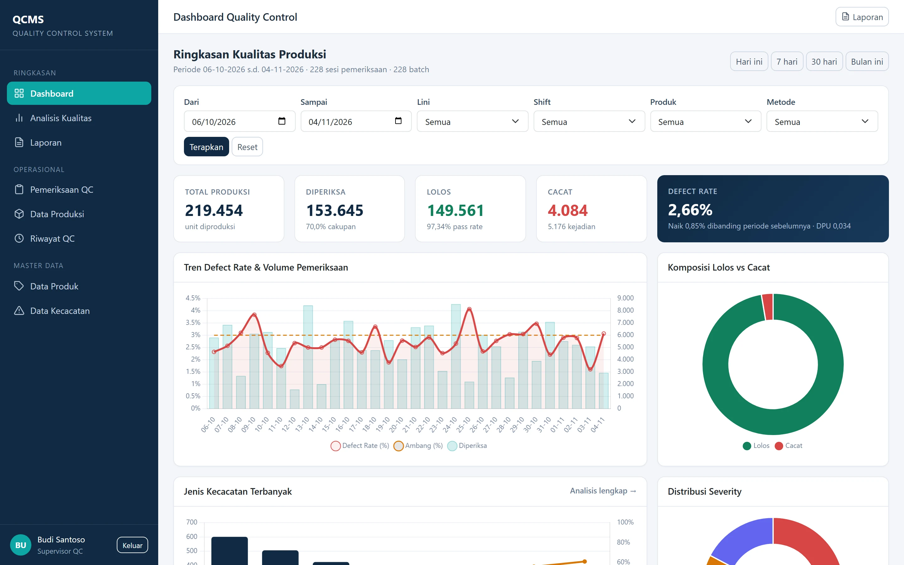
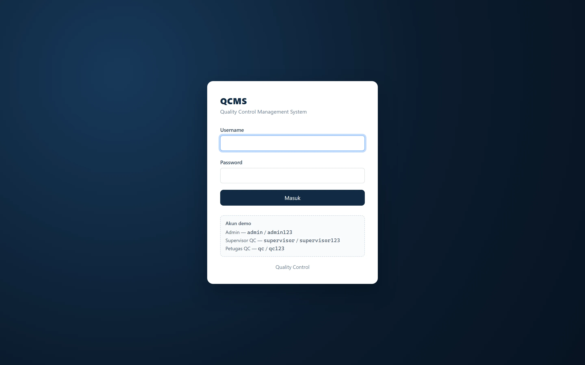
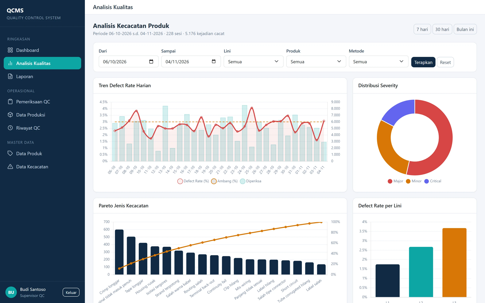
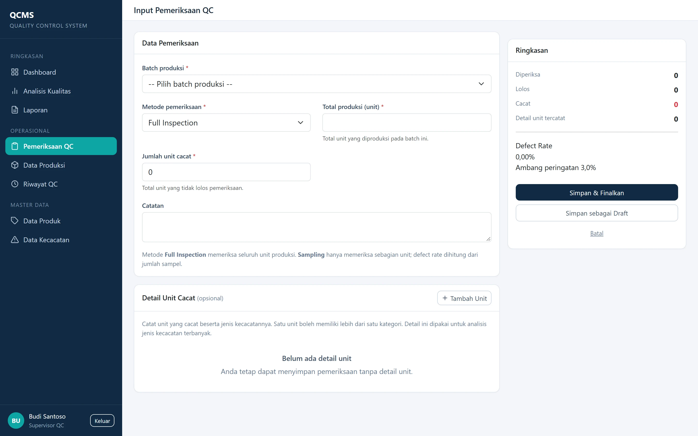
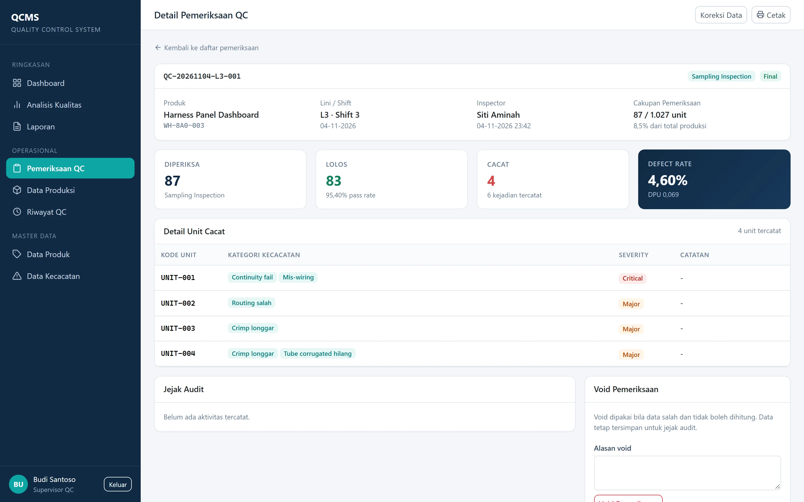
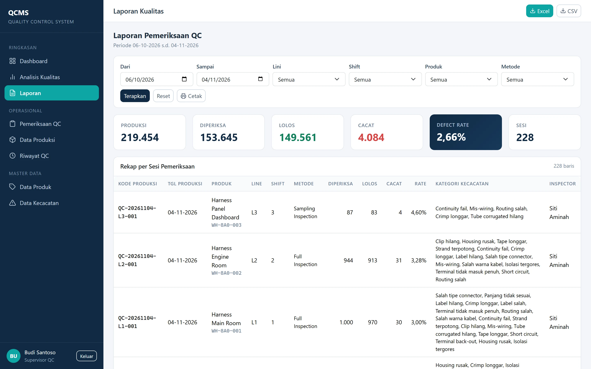
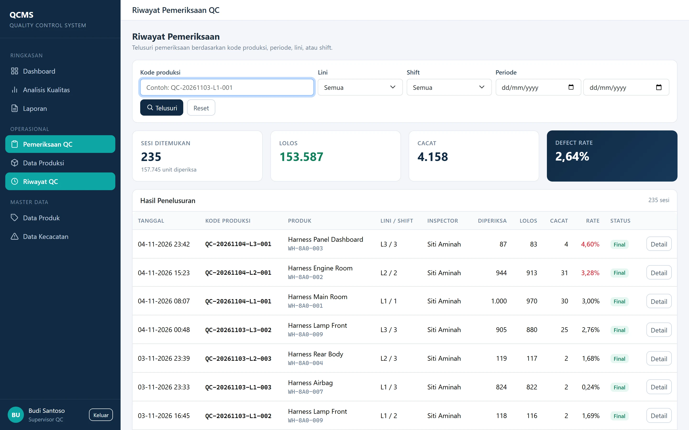
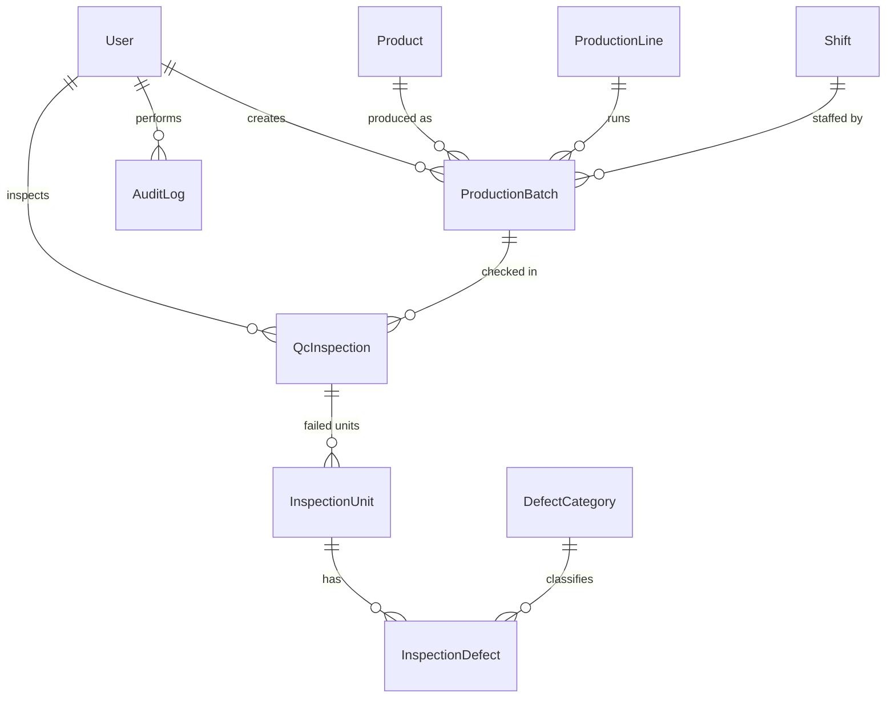

# QCMS — Quality Control Management System

**English** · [Bahasa Indonesia](README.id.md)

A production-quality web app for recording quality control inspections of
automotive wiring harnesses: automatic production codes, defect tracking down to
the individual unit, a defect-rate dashboard, Pareto analysis, and CSV/Excel
export.

Built with **Python 3.12 · Django 6 · PostgreSQL / SQLite · Docker**. No IoT
hardware, no JavaScript framework — deliberately small enough for one engineer
to maintain inside a factory.

[](https://github.com/RizkiHadiono/django-qcms/actions/workflows/ci.yml)




---

## The problem

In a wiring harness plant, QC results are written on paper per shift. Three
things go wrong:

1. **Recap takes hours.** Someone re-types the whole shift into a spreadsheet.
2. **Traceability is lost.** When a customer reports a defect, nobody can find
   which inspection covered that production code.
3. **Defect-rate maths is quietly wrong.** The most common mistake is dividing
   defective units by *total production* instead of by *units actually
   inspected*. Under sampling, that understates the rate — often by an order of
   magnitude.

QCMS replaces the paper form and fixes point 3 by construction.

## What it does

| Page | Function |
|---|---|
| Login | Three roles: Admin, QC Supervisor, QC Officer |
| Dashboard | KPI cards, defect-rate trend, pass/fail composition, threshold alerts |
| Inspection entry | Full inspection or sampling, plus per-unit multi-defect detail |
| Production data | Batches with auto-generated code `QC-YYYYMMDD-L<n>-<seq>` |
| Inspection history | Search by production code, date range, line, shift |
| Quality analysis | Daily trend, Pareto of defect types, severity, per line/product |
| Reports | Per-session recap, CSV and Excel export, print layout |
| Master data | Products, production lines, shifts, defect categories |
| User management | Accounts and role assignment |

## Screenshots

| | |
|---|---|
|  |  |
| **Login** — role-based access | **Analysis** — Pareto and severity breakdown |
|  |  |
| **Inspection entry** — fast line-side input | **Detail** — per-unit defects, audit trail |
|  |  |
| **Reports** — recap and export | **History** — traceability by production code |

More in [`docs/screenshots/`](docs/screenshots/).

---

## Engineering decisions

This is the part worth reading. Each decision has a trade-off.

### 1. Defect rate is computed from inspected units, not total production

```
defect_rate = qty_fail / qty_inspected × 100
```

Under *full inspection*, `qty_inspected == total_production`. Under *sampling*
they differ, and using total production would produce a number that looks
reassuring and is wrong. The reference case — 1,000 inspected, 970 passed,
30 defective — must yield exactly **3.00%**, and there is a test asserting it.

### 2. Hybrid data model: aggregate header + detail rows only for defective units

A batch can be 1,200 units. Storing 1,200 rows per inspection would make
line-side entry slow and the database large for no benefit.

```
QcInspection   qty_inspected / qty_pass / qty_fail   ← always present
InspectionUnit     only for units that actually failed
InspectionDefect   one row per defect category per failed unit
```

The detail is **optional**: an inspector can record 30 defective units in
seconds without naming them. The detail page then lists how many defective
units still lack a category, so the gap is visible rather than silently lost.

### 3. Pareto counts defect *occurrences*; defect rate counts *units*

One unit can carry several defects (crimp loose **and** wrong wire colour).
Those are two different questions:

- *How many units do I scrap?* → units → defect rate
- *What should engineering fix first?* → occurrences → Pareto

Both are shown, plus **DPU** (defects per unit) so the two views reconcile.
Conflating them is the most common analysis error in QC dashboards.

### 4. Nothing is deleted — rows are *voided* with a mandatory reason

`status` is `draft`, `final`, or `void`. Voided and draft sessions are excluded
from every dashboard and report, but the row survives with `void_reason`,
`voided_by`, and `voided_at`. Final sessions can only be corrected by a
Supervisor or Admin, and every correction writes an `AuditLog` entry.

For a quality system, a gap in the record is worse than a wrong record that is
visibly corrected.

### 5. Production codes are generated per line and per day, inside a transaction

```
QC-20261103-L1-001
   │        │  └─ sequence, resets daily per line
   │        └──── production line
   └───────────── production date
```

`select_for_update()` plus a retry loop on `IntegrityError` handles concurrent
inserts. A single global counter would have been simpler but unreadable on the
shop floor, where people refer to codes out loud.

### 6. Excel export writes real numbers, not text

`openpyxl` will happily write `"4,60"` as a string. The file then looks correct
and cannot be summed. Numeric columns are written as `int`/`float` with
`#,##0` / `0.00` formats, so `SUM` and `AVERAGE` work out of the box.

### 7. Bootstrap and Chart.js are vendored locally

Factory networks are frequently offline or heavily firewalled. `static/vendor/`
holds the libraries; there is no CDN dependency at runtime.

### 8. Container always runs `DEBUG=False`

`DEBUG` in `.env` applies to local `runserver` only. The compose file hardcodes
`DEBUG: "False"`, so a stray `.env` cannot leak tracebacks to the shop floor.

---

## Architecture



| App | Responsibility |
|---|---|
| `core` | Layout, navigation, RBAC decorators, template tags, demo seeding |
| `accounts` | Custom `User` with `role`, login, user management |
| `masterdata` | Products, lines, shifts, defect categories |
| `production` | Batches and the production-code generator |
| `inspection` | Inspection sessions, units, defects, void/correct services |
| `reporting` | Dashboard, analysis, reports, CSV/XLSX export |
| `auditlog` | Immutable trail of create/update/void actions |

Business logic lives in `services.py` modules rather than views, so the
calculations are unit-testable without HTTP.

```
config/            settings, urls, wsgi
apps/              one Django app per bounded context
templates/         Bootstrap templates, one folder per app
static/            css, js, vendored libraries
docs/              PRD, decision notes, screenshots
scripts/           screenshot generator
```

---

## Getting started

### Docker (recommended)

```bash
docker compose up -d --build
```

Open <http://localhost:8080>. Migrations and demo data run automatically on
first start.

| Role | Username | Password |
|---|---|---|
| Admin | `admin` | `admin123` |
| QC Supervisor | `supervisor` | `supervisor123` |
| QC Officer | `qc` | `qc123` |

> Port **8080** is used because 8000 is commonly already taken. Change it in
> `docker-compose.yml` under `ports`.

### Local, without Docker

```bash
python -m venv .venv && .venv\Scripts\activate   # Windows
pip install -r requirements.txt
cp .env.example .env
python manage.py migrate
python manage.py seed_demo --days 30
python manage.py runserver 8081
```

Uses SQLite by default. Set `DATABASE_URL` to switch to PostgreSQL.

### Useful commands

```bash
docker compose logs -f web                 # follow logs
docker compose restart web                 # reload Python/templates
docker compose up -d --build               # rebuild after CSS/JS/requirements changes
docker compose exec db psql -U qc -d qc_db # open PostgreSQL
docker compose down                        # stop, keep data
docker compose down -v                     # stop, delete data
```

## Testing

```bash
pip install -r requirements-dev.txt
ruff check . && ruff format --check .
coverage run --source=apps manage.py test apps
coverage report
```

**27 tests**, ~76% statement coverage. They assert business rules, not just
status codes: the 1,000/970/30 reference case, multi-defect unit counting,
sampling validation, per-line code sequencing, role permissions, void requiring
a reason, correction rewriting unit detail, and CSV/XLSX content parity with the
on-screen report.

CI runs lint, migrations, tests, and a Docker build on every push.

## Configuration

| Variable | Default | Purpose |
|---|---|---|
| `SECRET_KEY` | dev value | Django secret; generate a new one in production |
| `DEBUG` | `True` | Local `runserver` only |
| `ALLOWED_HOSTS` | `localhost,127.0.0.1` | Comma-separated |
| `DATABASE_URL` | *(empty → SQLite)* | e.g. `postgres://qc:qc@db:5432/qc_db` |
| `QC_DEFECT_RATE_THRESHOLD` | `3.0` | Alert threshold in percent |
| `APP_NAME` / `APP_DESCRIPTION` | `QCMS` / … | White-label identity |
| `APP_COMPANY` | *(empty)* | Shown in the login footer when set |
| `SEED_DEMO` | `0` | Seed demo data on container start |
| `DEMO_MODE` | `False` | Show a "public demo" banner |
| `HTTPS_ENABLED` | `False` | Enable HSTS, secure cookies, SSL redirect |

## Deploying to a factory server

1. Copy the project, create `.env` with `DEBUG=False`, a fresh `SECRET_KEY`,
   `ALLOWED_HOSTS` set to the office domain/IP, and `DATABASE_URL`.
2. `docker compose up -d --build`.
3. Daily backup: `docker compose exec db pg_dump -U qc qc_db > backup.sql`.
4. For HTTPS, put Nginx/Caddy in front of port 8080, set `HTTPS_ENABLED=True`
   and `CSRF_TRUSTED_ORIGINS`.

A `render.yaml` blueprint is included if you want to try a free public
deployment (SQLite + seeded data, so nothing expires). The project does not
require it — running locally or on a factory server is fully supported.

## A note on language

The UI, code comments, and `docs/` are in **Indonesian**, because the people
using this are Indonesian factory operators and QC staff. Translating the
interface would make it worse at its job. This README is in English so the
project is reviewable by a wider audience.

## License

[MIT](LICENSE). Company and personnel names in the demo data are fictional.
